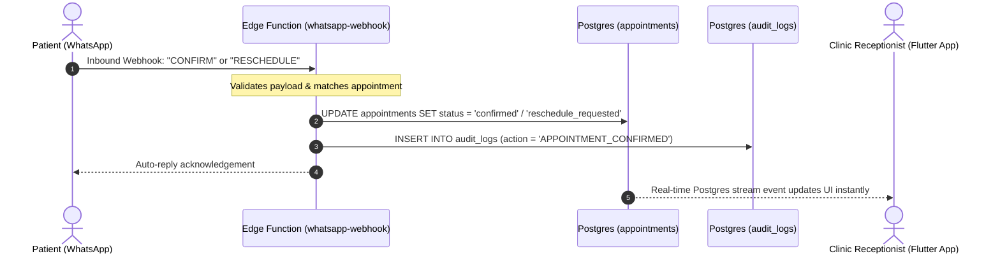
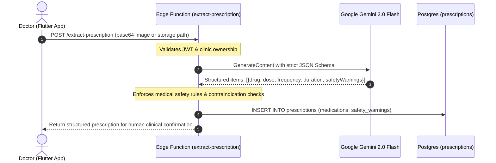
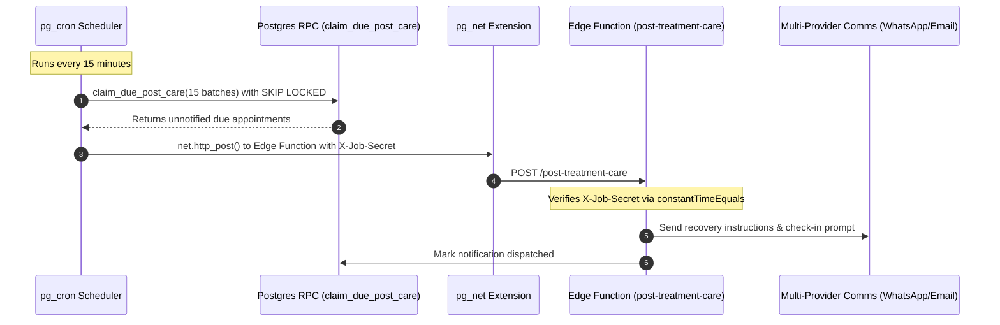

# 🦷 CareTrack — Clinical Retention Platform for Dental Clinics

[](https://flutter.dev)
[](https://dart.dev)
[](https://supabase.com)
[](https://deno.land)
[](https://ai.google.dev)
[](https://www.meity.gov.in)
[](#-free-tier-deployment-guide)
[](LICENSE)

**CareTrack** is an enterprise-grade clinical retention and patient engagement platform purpose-built for dental clinics. It evolves traditional clinic software into an active patient relationship engine: automating multi-stage dental treatment plans, tracking medication adherence, conducting two-way patient communication with automated emergency triage, and recommending personalized recall intervals using Gemini 2.0 Flash—all on **Supabase** (PostgreSQL, Row Level Security, Auth, Storage, Edge Functions, and `pg_cron`).

> [!IMPORTANT]
> **Strict Clinical Scope Boundary**: CareTrack is exclusively focused on clinical workflow, recall automation, and patient retention. There are **zero billing, payment, invoice, UPI, or subscription features** in the platform. Everything runs cleanly on Supabase's free tier with zero credit card required.

---

## 📑 Table of Contents

- [System Architecture](#-system-architecture)
- [Sequence Diagrams](#-sequence-diagrams)
- [Core Platform Capabilities](#-core-platform-capabilities)
- [Multi-Clinic Tenant Isolation & Staff Roles](#-multi-clinic-tenant-isolation--staff-roles)
- [Free Tier Deployment Guide](#-free-tier-deployment-guide)
- [Local Development Setup](#-local-development-setup)
- [Environment Variables & Zero-Secret Policy](#-environment-variables--zero-secret-policy)
- [DPDP Act 2023 Compliance & Data Protection](#-dpdp-act-2023-compliance--data-protection)
- [Automated Testing & CI/CD](#-automated-testing--cicd)

---

## 🏛 System Architecture

CareTrack pairs a high-performance Flutter frontend (Web, Desktop, Android, iOS) with a pure Supabase backend architecture:

```
+-----------------------------------------------------------------------------------+
|                           CARETRACK CLIENT APPLICATIONS                           |
|                                                                                   |
|  +--------------------------------+          +---------------------------------+  |
|  |     Flutter Web / Desktop      |          |       Flutter Mobile (Android)  |  |
|  |   - Receptionist Split Shell   |          |   - Doctor & Staff Mobile App   |  |
|  |   - Responsive Dashboard       |          |   - Floating BottomNavPill      |  |
|  +--------------------------------+          +---------------------------------+  |
+------------------------------------------+----------------------------------------+
                                           | HTTPS / WSS (Supabase Dart SDK + JWT)
                                           v
+-----------------------------------------------------------------------------------+
|                        SUPABASE EDGE FUNCTIONS GATEWAY                            |
|                                                                                   |
|  Deno v2 TypeScript Functions (Zod Validated, generic errors, audit-logged)       |
|  +------------------------+  +------------------------+  +---------------------+  |
|  |    Public Endpoints    |  |  Staff/Owner Endpoints |  |   Scheduled Jobs    |  |
|  |  - get-slots           |  |  - create-staff        |  |  - medication-      |  |
|  |  - book-slot           |  |  - treatment-plans     |  |    reminders         |  |
|  |  - confirm-appointment |  |  - send-notifications  |  |  - post-treatment-   |  |
|  |  - whatsapp-webhook    |  |  - extract-prescription|  |    care              |  |
|  |  - send-direct-message |  |  - patient-data-tools  |  |  - pg_cron dispatcher|  |
|  +------------------------+  +------------------------+  +---------------------+  |
+------------------------------------------+----------------------------------------+
                                           | Database Pooler / Transaction RLS
                                           v
+-----------------------------------------------------------------------------------+
|                              SUPABASE POSTGRESQL 15+                              |
|                                                                                   |
|  +---------------------------+  +--------------------+  +----------------------+  |
|  |   Postgres Tables & RLS   |  |  Storage & Vault   |  |  pg_cron Extensions |  |
|  |  - clinics & profiles     |  |  - private bucket: |  |  - pg_cron & pg_net  |  |
|  |  - patients & visits      |  |    'prescriptions' |  |  - SKIP LOCKED queue |  |
|  |  - treatment_plans        |  |  - Supabase Vault  |  |  - idempotent job    |  |
|  |  - immutable audit_logs   |  |    secret storage  |  |    execution         |  |
|  +---------------------------+  +--------------------+  +----------------------+  |
+-----------------------------------------------------------------------------------+
```

---

## 🔄 Sequence Diagrams

### 1. Two-Way Appointment Confirmation Flow



### 2. Clinical Prescription Parsing & Safety Verification Flow



### 3. Scheduled Automated Follow-up Dispatcher (`pg_cron`)



---

## 🌟 Core Platform Capabilities

### 1. Multi-Stage Dental Treatment Plans
- Structured clinical pipelines for complex multi-visit procedures (Root Canal Therapy, Orthodontic Aligners, Implants, Periodontal Scaling).
- Automatically advances stages upon doctor sign-off and queues proposed next visits in the clinic dashboard.

### 2. Multi-Provider Patient Communication Engine
- Seamless abstraction supporting **WhatsApp Cloud API**, **Telegram Bot API**, and **Brevo / SMTP Email**.
- Automated emergency triage detects keywords (*"severe pain"*, *"bleeding"*, *"swelling"*, *"pus"*, *"fever"*) and flags conversations with high priority.

### 3. Medication Reminders & Adherence Tracking
- Automated dose reminders delivered at morning, afternoon, evening, and bedtime.
- Patient confirmation tracking with real-time adherence rates calculated for clinical oversight.

### 4. Smart Public Slot Booking & Tokenized Self-Service
- Anti-abuse protected online booking engine with per-IP rate-limiting.
- Issues cryptographically signed HMAC-SHA256 management tokens for patient self-service cancellation and rescheduling without requiring app logins.

### 5. Responsive Material 3 Design
- Modern clinical color system: Deep Navy (`#0F2A47`), Clinical Teal (`#0F766E`), Mint Accent (`#2DD4BF`), and Background Grey (`#F3F6FA`).
- Dual-pane master-detail desktop/web sidebar (`>= 900px`) and floating `BottomNavPill` on mobile.

---

## 👥 Multi-Clinic Tenant Isolation & Staff Roles

| Role | Access Level | Responsibilities |
|---|---|---|
| **owner** | Full Clinic Admin | Clinic profile management, staff creation, DPDP data export & right-to-erasure tools |
| **doctor** | Full Clinical | Patient medical history, prescription writing, treatment plans, manual trigger of scheduled jobs |
| **receptionist** | Operations & Front Desk | Appointment booking, WhatsApp inbox chats, check-ins, recall queue dispatch |
| **view_only** | Read-Only Audit | Read-only inspection for dental interns, hygienists, or external compliance auditors |

Row Level Security (RLS) is enforced at the database kernel level using `auth.jwt() -> 'app_metadata' -> 'clinic_id'` and `role`. Cross-clinic data leakage is impossible even if client queries are tampered with.

---

## 🚀 Free Tier Deployment Guide

CareTrack runs 100% on Supabase's generous free tier:

1. **Create Free Project**:
   - Go to [database.new](https://database.new) and create a project (no credit card needed).
2. **Link Local Project**:
   ```bash
   supabase login
   supabase link --project-ref <YOUR_PROJECT_ID>
   ```
3. **Push Schema & Migrations**:
   ```bash
   supabase db push
   ```
4. **Deploy Edge Functions**:
   ```bash
   supabase functions deploy --no-verify-jwt whatsapp-webhook
   supabase functions deploy --no-verify-jwt get-slots
   supabase functions deploy --no-verify-jwt book-slot
   supabase functions deploy --no-verify-jwt confirm-appointment
   supabase functions deploy
   ```
5. **Configure Production Secrets**:
   ```bash
   supabase secrets set \
     JOB_SHARED_SECRET="<generate-random-64-char-hex>" \
     GEMINI_API_KEY="<your-google-ai-key>" \
     WHATSAPP_TOKEN="<meta-token>" \
     BREVO_API_KEY="<brevo-token>"
   ```

---

## 💻 Local Development Setup

### 1. Prerequisites
- [Supabase CLI](https://supabase.com/docs/guides/cli): `npm install -g supabase`
- [Docker Desktop](https://www.docker.com/) (required to run local PostgreSQL & Edge Functions)
- [Deno v2+](https://deno.land/)
- [Flutter SDK 3.24+](https://flutter.dev/)

### 2. Start Local Supabase Stack
```bash
supabase start
supabase db reset
```

The database reset applies all migrations (`0001` through `0004`) and seeds demo clinic data:
- **Demo Owner:** `owner.demo@caretrack.local` / `Password@123`
- **Demo Doctor:** `doctor.a@caretrack.local` / `Password@123`
- **Demo Receptionist:** `receptionist.demo@caretrack.local` / `Password@123`

### 3. Launch the Flutter App
```bash
cd caretrack_app
flutter pub get

# For Web or Desktop:
flutter run -d chrome \
  --dart-define=SUPABASE_URL=http://127.0.0.1:54321 \
  --dart-define=SUPABASE_ANON_KEY=<LOCAL_ANON_KEY>

# For Android Emulator:
flutter run \
  --dart-define=SUPABASE_URL=http://10.0.2.2:54321 \
  --dart-define=SUPABASE_ANON_KEY=<LOCAL_ANON_KEY>
```

---

## 🔐 Environment Variables & Zero-Secret Policy

### Client App (`--dart-define` Only)
The Flutter application is strictly sandboxed. It contains **no** private keys, AI tokens, or service role credentials:
- `SUPABASE_URL`: Public Supabase Project URL
- `SUPABASE_ANON_KEY`: Public anonymous API key (secured by RLS policies)
- `STORE_PRESCRIPTION_IMAGES`: (Optional, default `false`). If `false`, images are passed as base64 payloads to Edge Functions, keeping storage at 0 bytes.

### Server Secrets (`supabase secrets set`)
- `JOB_SHARED_SECRET`: Cryptographic shared key for scheduled cron invocation
- `GEMINI_API_KEY`: Google AI studio key for structured JSON extraction
- `WHATSAPP_TOKEN` / `TELEGRAM_BOT_TOKEN` / `BREVO_API_KEY`: Messaging service providers

---

## 🛡 DPDP Act 2023 Compliance & Data Protection

- **Data Minimization:** No Aadhaar, financial, or unneeded identifiers are collected.
- **Data Subject Access Request (DSAR):** Owner-executable JSON bundle archive export via `/patient-data-tools` (action = `export`).
- **Right to Erasure:** Complete deletion of patient medical records, appointments, and prescriptions upon verified subject request via `/patient-data-tools` (action = `erase`).
- **Immutable Audit Logging:** System writes immutable audit trails (`audit_logs` table) for all export, erase, and role change events.
- **PII Masking:** Phone numbers and sensitive identifiers are masked in server telemetry logs (`+91******1234`).

---

## 🧪 Automated Testing & CI/CD

CareTrack enforces automated testing on every push and pull request via [GitHub Actions CI](.github/workflows/ci.yml):

- **Flutter Analysis & Tests:**
  ```bash
  cd caretrack_app
  flutter analyze
  flutter test
  ```
- **Supabase Edge Functions Type Checks & Tests:**
  ```bash
  deno check supabase/functions/*/index.ts
  deno test --allow-all supabase/tests/functions_test.ts
  deno test supabase/tests/rls_test.ts
  ```

---

## 📄 License

This project is licensed under the MIT License — see the [LICENSE](LICENSE) file for details.
