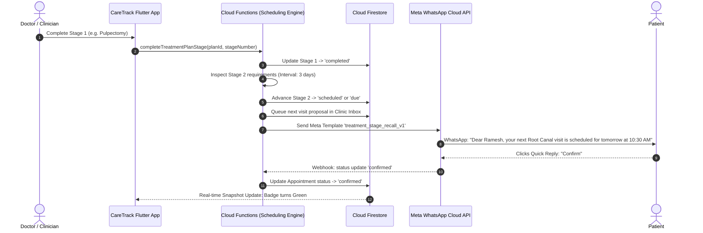

# CareTrack Platform Architecture

CareTrack is an enterprise-grade clinical retention platform engineered specifically for dental clinics. It evolves traditional dental practice management by automating multi-stage treatment recall, adherence tracking, two-way WhatsApp patient engagement, and AI-assisted workflow optimization—while strictly maintaining multi-tenant isolation, clinical discretion, and zero-PII audit trails.

---

## 1. High-Level System Architecture

CareTrack is built on a modern serverless, cloud-native architecture combining a responsive Flutter client with Firebase Cloud Functions v2 (Node.js 20 / TypeScript) and Google Cloud services.

```
+-----------------------------------------------------------------------------------+
|                                  CLIENT LAYER                                     |
|                                                                                   |
|  +--------------------------------+          +---------------------------------+  |
|  |     Flutter Web / Desktop      |          |       Flutter Mobile (Android)  |  |
|  |   - Receptionist Split Shell   |          |   - Doctor & Staff Mobile App   |  |
|  |   - Responsive Dashboard       |          |   - Instant Notification Feed   |  |
|  +--------------------------------+          +---------------------------------+  |
+------------------------------------------+----------------------------------------+
                                           | HTTPS / WSS (App Check Protected)
                                           v
+-----------------------------------------------------------------------------------+
|                             API & CLOUD LOGIC LAYER                               |
|                                                                                   |
|  Firebase Cloud Functions v2 (TypeScript / Node 20)                              |
|  +------------------------+  +------------------------+  +---------------------+  |
|  |   Callable Functions   |  |   Webhook Endpoints    |  |  Scheduled Tasks    |  |
|  |  - Auth & Role Claims  |  |  - Meta WhatsApp       |  |  - 24h Reminders    |  |
|  |  - Treatment Plans     |  |    (Rate-limited)      |  |  - Recall Campaigns |  |
|  |  - AI Recalls & Parsing|  |  - Public Slot Booking |  |  - Med Reminders    |  |
|  |  - DPDP Consent & Export| |    (CAPTCHA-protected) |  |  - Daily Backups    |  |
|  +------------------------+  +------------------------+  +---------------------+  |
+------------------------------------------+----------------------------------------+
                                           | Internal IAM & Admin SDK
                                           v
+-----------------------------------------------------------------------------------+
|                              DATA & AI SERVICES                                   |
|                                                                                   |
|  +---------------------------+  +--------------------+  +----------------------+  |
|  |     Cloud Firestore       |  |   Cloud Storage    |  |    Google Gemini     |  |
|  |  - Multi-tenant isolation |  |  - Prescription Rx |  |  - Gemini 1.5 Flash  |  |
|  |  - Subcollection isolation|  |    Scans (secure)  |  |  - Structured JSON   |  |
|  |  - Zero-PII Audit Trail   |  |  - Automated GCS   |  |  - Doctor-confirmed  |  |
|  |  - Real-time listeners    |  |    Daily Backups   |  |    clinical advisory |  |
|  +---------------------------+  +--------------------+  +----------------------+  |
+-----------------------------------------------------------------------------------+
```

---

## 2. Multi-Tenant Clinic Isolation

Every record in CareTrack belongs to an explicit `clinicId`. Multi-tenant boundaries are enforced across two defense-in-depth perimeters:

1. **Firestore Security Rules**:
   - Every read and write validates that `request.auth.token.clinicId == resource.data.clinicId` (or matching path prefix).
   - Staff roles (`owner`, `doctor`, `receptionist`) are embedded into Firebase Auth Custom Claims.
   - Clinical documents (e.g., prescriptions) are strictly restricted to doctors and owners; receptionists cannot access medication or clinical details.
2. **Cloud Functions Runtime Guard**:
   - Backend callables verify `context.auth.token.clinicId` and match against target documents before executing updates or queries.
   - Cross-clinic access attempts immediately trigger a security error and are recorded in the security audit log.

---

## 3. Strict Non-Financial Boundary

CareTrack is exclusively a clinical retention platform. By architectural mandate:
- **No payment gateways** (Stripe, Razorpay, PayPal) exist anywhere in the platform.
- **No billing, invoices, or accounting ledgers** are maintained.
- **No subscription charging or financial transactions** are processed.
All appointment booking and recall interactions focus strictly on clinical scheduling, post-op instructions, medication adherence, and health retention.

---

## 4. Mermaid Sequence Diagrams

### Diagram 1: Multi-Stage Treatment Plan Scheduling & Automated Follow-Up Proposal

This workflow illustrates how a multi-visit clinical procedure (e.g., Root Canal, Crown Cementation, Periodontal Curettage) automatically schedules next visits and prompts receptionists when stages complete.



---

### Diagram 2: Two-Way WhatsApp Webhook, Reply Routing & Emergency Triage

This workflow illustrates how inbound WhatsApp messages from patients are ingested, checked for emergency keywords, routed to the clinic inbox, and handled by staff.

```mermaid
sequenceDiagram
    autonumber
    actor Patient as Patient
    participant Meta as Meta WhatsApp Gateway
    participant Webhook as whatsappWebhook (Rate-Limited CF)
    participant Triage as Emergency Triage Engine
    participant DB as Cloud Firestore
    actor Staff as Receptionist / Doctor
    participant App as Clinic Inbox (Flutter)

    Patient->>Meta: "Experiencing severe swelling and continuous bleeding after surgery"
    Meta->>Webhook: POST /whatsappWebhook (JSON Payload)
    Webhook->>Webhook: Validate X-Hub-Signature-256
    Webhook->>Triage: Analyze inbound text for clinical emergencies
    Note over Triage: Detects keywords: "swelling", "bleeding" -> High Priority
    Triage->>DB: Create message thread with triageStatus: 'urgent'
    Triage->>DB: Write unread notification to staff
    DB-->>App: Real-time Stream triggers High-Priority Alert Banner
    Staff->>App: Opens Clinic Inbox, selects Urgent Thread
    Staff->>App: Types immediate clinical reply & instructions
    App->>Webhook: sendClinicMessage(threadId, replyText)
    Webhook->>Meta: Send WhatsApp Text Message
    Meta->>Patient: "Please apply firm gauze pressure immediately and come to the clinic; Dr. Patel is waiting."
```

---

## 5. DPDP Act 2023 Compliance & Data Protection

CareTrack adheres strictly to the Digital Personal Data Protection Act (DPDP Act 2023, India):

1. **Explicit Notice & Consent**:
   - Patients have granular consent records stored in their profile (`messagingConsent` and `aiProcessingConsent`), along with the acquisition method (`in_person`, `whatsapp_opt_in`, `web_booking`, `paper_form`) and audit timestamps.
2. **Right to Access (Data Portability)**:
   - Clinic owners can invoke `exportPatientData` to download a complete, structured JSON export of all clinical visits, prescriptions, reminders, and messages associated with the patient.
3. **Right to Erasure**:
   - Clinic owners can invoke `erasePatientData` with a recorded clinical reason. The backend permanently anonymizes identifying details, removes prescription image files from Cloud Storage, and preserves a zero-PII audit record.
4. **Zero Plaintext PII in Logs**:
   - All logging frameworks automatically filter out patient names, phone numbers, email addresses, and clinical text before sending to Google Cloud Logging.
